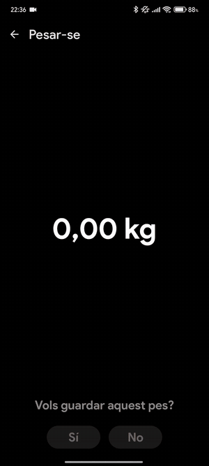
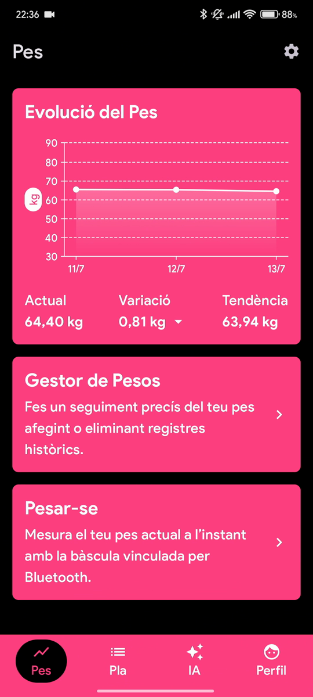
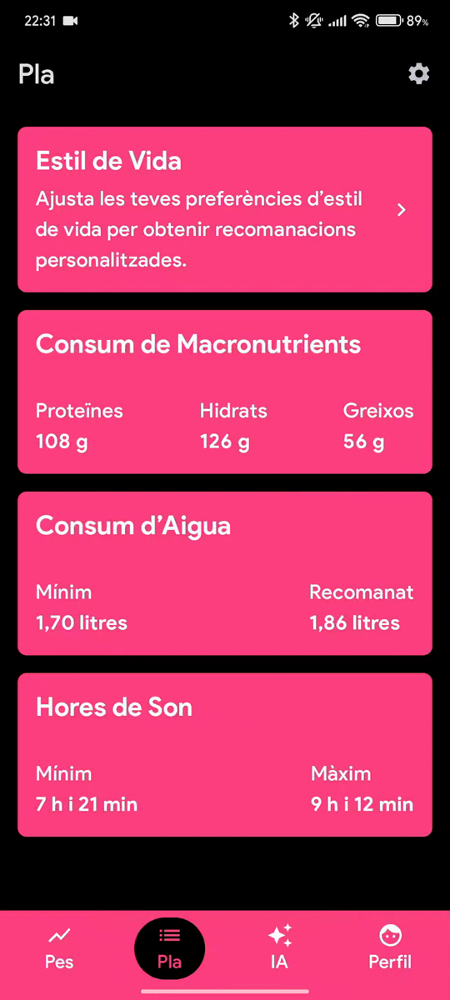
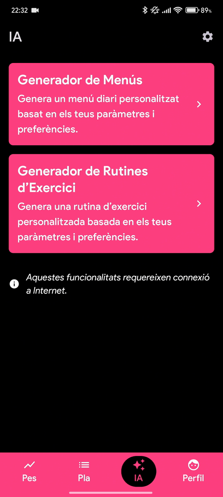
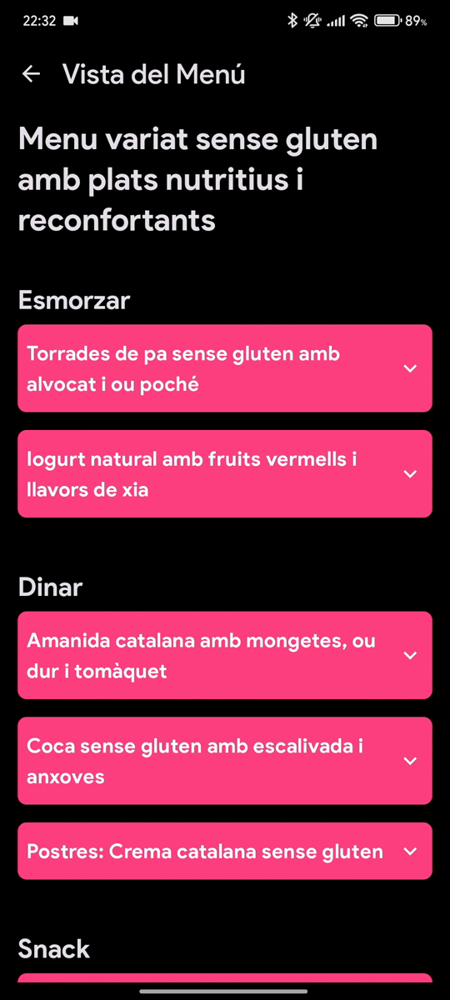
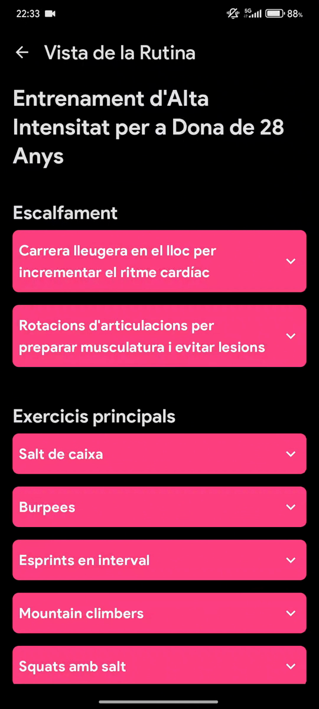
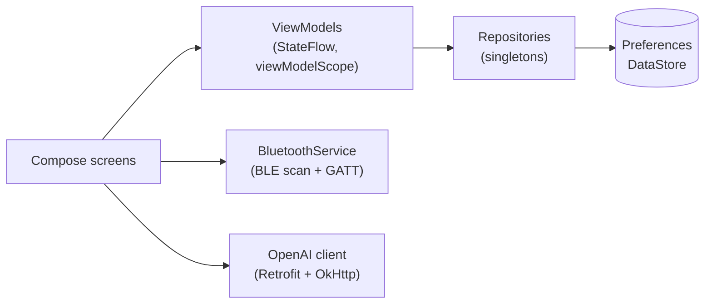

<p align="center">
  
</p>

<h1 align="center">FitTrack</h1>

<p align="center">
  Android fitness app that reads your weight live from a Bluetooth smart scale, tracks your progress,<br>
  calculates daily nutrition targets and generates menus and workouts with AI.
</p>

<p align="center">
  Kotlin · Jetpack Compose · Material 3 · Bluetooth LE · OpenAI API · Android 8 – 16
</p>

<p align="center">
  
  &nbsp;
  
  &nbsp;
  
</p>
<p align="center">
  
  &nbsp;
  
  &nbsp;
  
</p>
<p align="center"><sub>Screenshots in Catalan; the app is also available in Spanish and English.</sub></p>

<p align="center">
  <a href="https://github.com/sergisabate/FitTrack/releases/latest"><b>⬇️ Download the latest APK</b></a>
  <br>
  <sub>Android 8.0+ · AI generators disabled in the prebuilt APK, see <a href="#build--run">Build & run</a></sub>
</p>

## About

FitTrack started as my Bachelor's final project in Computer Engineering (Universitat de Lleida), built solo from scratch while learning Kotlin and Jetpack Compose, and kept evolving afterwards up to Android 16 support.

Before writing code I ran a market study and a user survey (29 respondents, ages 18–35). Three findings shaped the product:

- **Privacy**: half of respondents were worried about how fitness apps use their data → everything is stored **locally on the device**, with no account and no cloud.
- **Device integration** was rated above 8/10 → automatic weigh-ins from a **Bluetooth LE smart scale**.
- **Personalisation** of existing apps was rated only 4–6/10 → menus and workouts **generated with AI** from the user's own profile and preferences.

## Features

- **Live Bluetooth weigh-in**: scans, pairs and reads a Xiaomi Mi Smart Scale 2 in real time, showing the weight as it stabilises.
- **Weight history**: interactive chart with current weight, variation and trend, plus a manager to add, edit or delete past records.
- **Daily plan**: protein, carbs and fat in grams, water intake and sleep hours, based on profile, activity level, calorie goal and macro split.
- **AI menus & workouts**: daily menus and exercise routines generated from the user's data and free-text preferences (e.g. "gluten free"), saved for later (up to 5 of each, to keep API cost and storage bounded).
- **Onboarding, profile and lifestyle** settings, with every recommendation recalculated when the data changes.
- **Light, dark or system theme**, and in-app language switch: **Spanish, Catalan, English**, including localised date and number formats.
- **Delete all my data**, protected by typing a confirmation phrase.

## How it works

### Architecture

MVVM with a single-activity Compose UI:



- **Repositories** wrap Preferences DataStore and expose `StateFlow`s that ViewModels and composables observe.
- **ViewModels** are created through small factories (`ViewModelsHelper.kt`), so composables get them with one call and repositories stay injectable.
- Navigation uses a bottom bar with four tabs (**Weight · Plan · AI · Profile**), plus settings and detail screens.

### Bluetooth scale

The Xiaomi Mi Smart Scale 2 has no public API. FitTrack subscribes to the standard Weight Scale service (`0x181D`) and its measurement characteristic (`0x2A9D`), then decodes the raw bytes: control flags (unit, stabilised, weight removed) and a little-endian weight value. The byte layout comes from the reverse-engineering work documented by the [openScale](https://github.com/oliexdev/openScale/wiki/Xiaomi-Bluetooth-Mi-Scale) project.

### Nutrition

There's no single agreed formula for basal metabolic rate, so FitTrack averages four well-known ones (**Harris-Benedict, Roza-Shizgal, Mifflin-St Jeor and Katch-McArdle**). It then applies the activity multiplier and calorie goal to get daily energy expenditure, splits it into macros (4 kcal/g for protein and carbs, 9 kcal/g for fat), and derives water and sleep targets from weight, age, gender and activity.

### AI generation

Requests go to the OpenAI Chat Completions API (`gpt-4.1-mini`, picked after comparing models for speed vs. quality) with a strict JSON schema in the prompt and `json_object` response format, so the answer deserialises straight into Kotlin data classes with Gson. Calls run in coroutines on `Dispatchers.IO`, after checking connectivity first. A menu takes about 5–10 seconds to generate.

## Tech stack

| Area | Choice |
|---|---|
| Language / UI | Kotlin, Jetpack Compose, Material 3 |
| Architecture | MVVM: Compose screens → ViewModels (StateFlow) → repositories |
| Persistence | Jetpack DataStore (Preferences) |
| Networking | Retrofit + OkHttp + Gson, coroutines |
| Hardware | Android Bluetooth LE (scan, GATT, notifications) |
| Charts | [Vico](https://github.com/patrykandpatrick/vico) |
| Build | Gradle Kotlin DSL, version catalog, AGP 9, R8 minification |
| Min / target SDK | 26 (Android 8.0) / 36 (Android 16) |

Tested on emulators and on three physical phones running Android 11, 12 and 15.

## Project structure

```
app/src/main/java/com/sergisabate/fittrack/
├── data/
│   ├── api/            OpenAI client (Retrofit) and request/response models
│   ├── bluetooth/      BLE scanning and scale packet parsing
│   ├── helpers/        nutrition calculations, locale fix, ViewModel providers
│   ├── repositories/   DataStore-backed repositories
│   └── viewmodels/     one ViewModel per feature
└── ui/
    ├── screens/        one composable per screen
    ├── components/ forms/ charts/ navigation/
    └── theme/          colours, typography, light/dark theme
```

## Build & run

Requirements: Android Studio (recent stable), JDK 17+, Android SDK 36.

```bash
git clone https://github.com/sergisabate/FitTrack.git
cd FitTrack
./gradlew assembleDebug        # or just open the project in Android Studio
./gradlew testDebugUnitTest    # unit tests
```

The app builds and runs **without any API key**: everything works except the AI generators, which show a notice. To enable them, add your own OpenAI key to `local.properties` (git-ignored):

```properties
openaiApiKey=sk-...
```

## Known limitations

- **API key on the client.** The OpenAI key is injected at build time through `BuildConfig`, so it ends up inside the APK. That's acceptable for a personal/academic project, but a production app should call OpenAI through its own backend so the key never leaves the server.
- **One supported scale**: Xiaomi Mi Smart Scale 2. Other scales using the standard Weight Scale service may work, but the stabilisation and removal flags are Xiaomi-specific.
- **Tests** cover the pure domain logic (BLE packet parsing and nutrition calculations); there are no UI tests.

## Roadmap

Ideas collected from user feedback on v1.0:

- **Daily calorie target** shown next to the macros, and the Plan tab as the home screen.
- **Weekly menus** generated in the background, so the user doesn't wait on a loading screen.
- **Dashboard** summarising weight, plan, menus and routines in one view.
- **Smartwatch integration** (steps, sleep, heart rate) to replace manual lifestyle settings with real data.
- **Optional cloud sync** through a backend, which would also move the OpenAI key off the device.

## License

Source code is published for portfolio and reference purposes. All rights reserved.

The bundled [Google Sans Flex](https://github.com/googlefonts/googlesans-flex) font is licensed under the [SIL Open Font License 1.1](licenses/GoogleSansFlex-OFL.txt).
